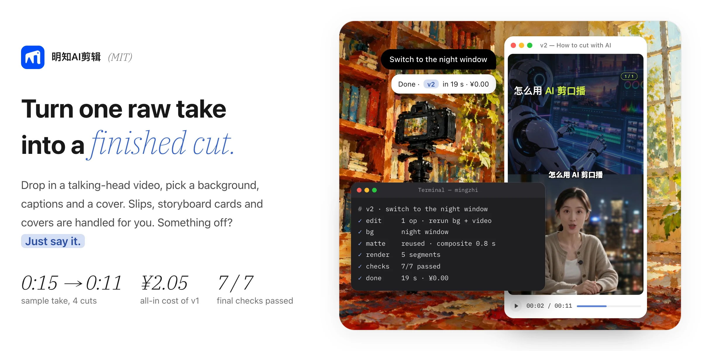
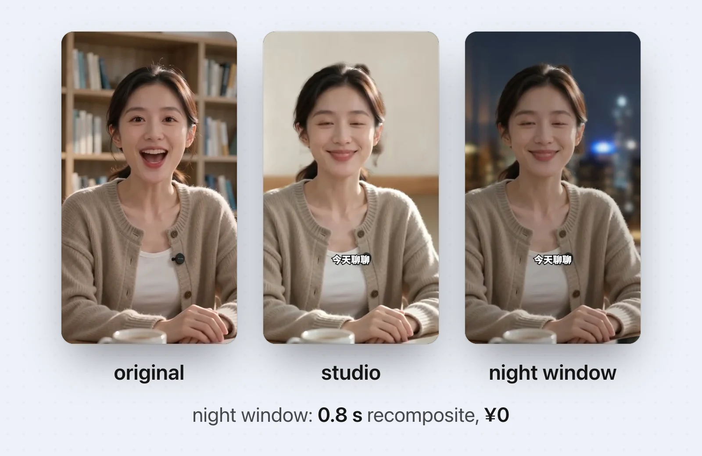
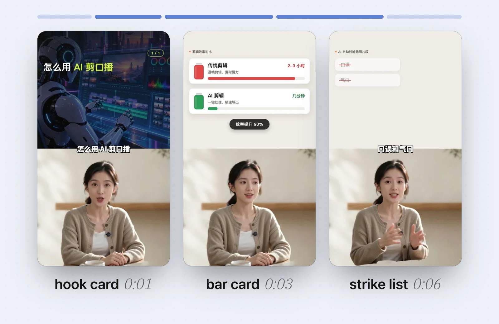
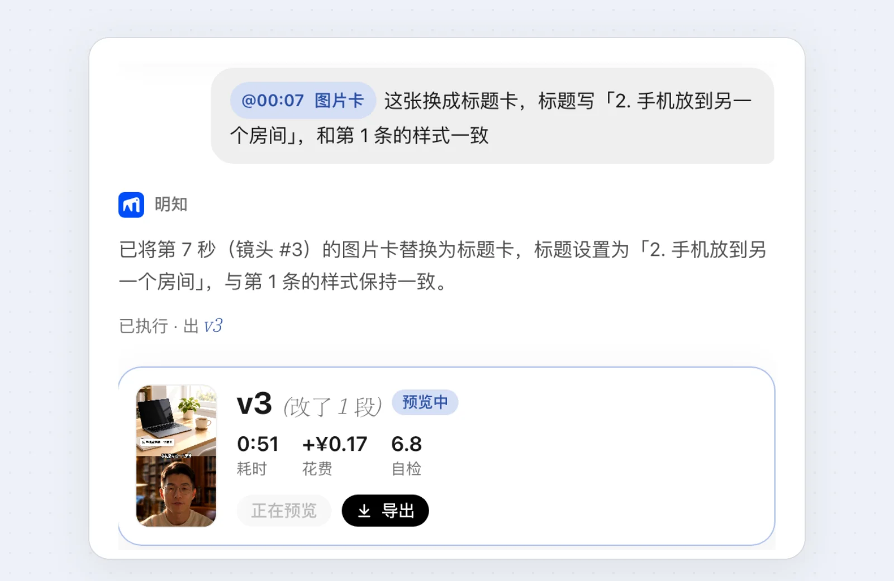
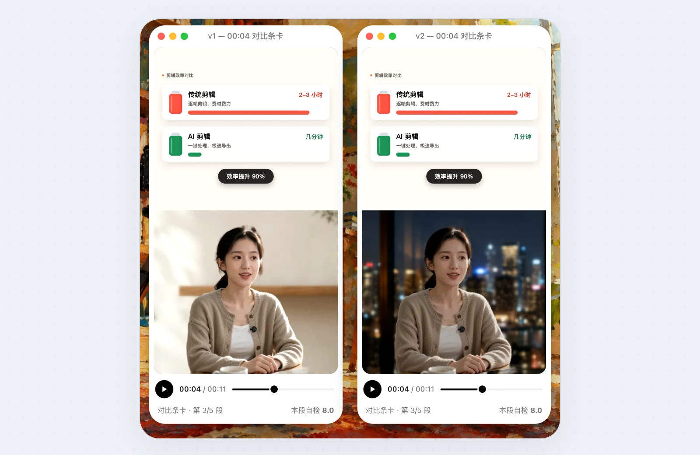
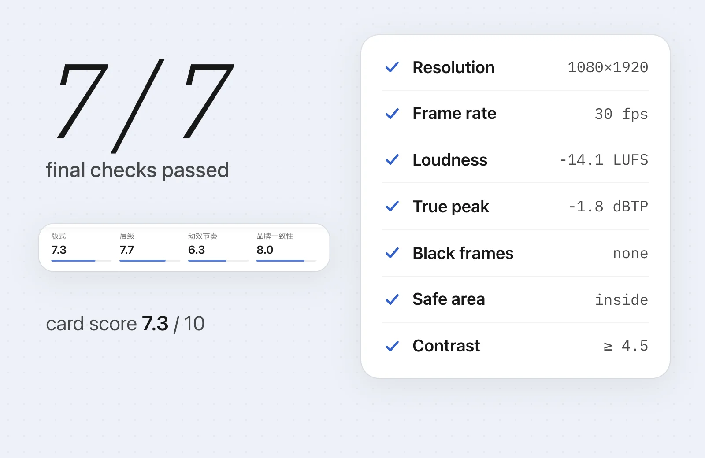
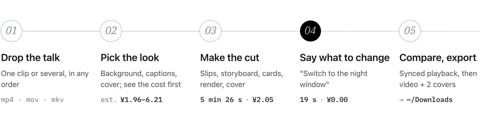

<div align="center">

<a href="#before--after">
<picture>
  <source media="(prefers-color-scheme: dark)" srcset="docs/readme/hero-en-dark.webp">
  
</picture>
</a>

<h1>Mingzhi AI Editor <sub>明知AI剪辑</sub></h1>

An open-source workbench that edits talking-head videos for you: it cuts the slips, swaps the background,<br>builds storyboard cards and covers, and hands back a vertical video ready to post. Want a change? Just say it.

[中文](README.md) · **English**

[![MIT][badge-license]][license] [![Node 22+][badge-node]][node] [![Speech recognition on device][badge-asr]](#privacy) [![Remotion 4][badge-remotion]][remotion] [![macOS · Windows][badge-os]](#minimum-specs)

#### [Before / after](#before--after) &nbsp;|&nbsp; [Screenshots](#screenshots) &nbsp;|&nbsp; [Features](#features) &nbsp;|&nbsp; [Quick start](#quick-start) &nbsp;|&nbsp; [Cost](#cost) &nbsp;|&nbsp; [Privacy](#privacy) &nbsp;|&nbsp; [FAQ](#faq)

</div>

<br>

> [!NOTE]
> The workbench UI, captions and cards are Chinese-first today, so the screenshots below are in Chinese.

## Before / after

Both speakers are AI-generated, fictional presenters, recorded with deliberate filler words and stutters. These are the first versions straight out of the workbench, with no manual touch-ups.


<p align="center"><sub><b>Landscape original → vertical cut</b>　1 filler and 3 repeats removed · minimalist studio background · 5 shots, 4 cards · 5 min 26 s · ¥2.05<br>
The animation is silent: <a href="docs/readme/before-after-landscape.mp4">open the MP4 with sound (2.2 MB)</a></sub></p>


<p align="center"><sub><b>Vertical original → vertical cut</b>　2 fillers and 2 repeats removed · library background · 6 shots, 5 cards · 6 min 15 s · ¥1.98<br>
<a href="docs/readme/before-after-portrait.mp4">Open the MP4 with sound (1.9 MB)</a></sub></p>

> [!NOTE]
> Apart from the few marked as the 2 min 12 s take, every number on this page was measured on these two takes (2026-10-15, Apple silicon Mac): times are what the workbench recorded, costs are what Kexiang AI actually charged. ¥1 is roughly US$0.14.

## Screenshots

The workbench is a local web page: conversation on the left, preview on the right. Everything from dropping in the take to exporting happens on this one page.


<p align="center"><sub>The first version. The left column shows what was cut, how many shots and how the cards scored; the preview plays shot by shot, and when paused you can "insert" that moment into the chat.</sub></p>

<table>
<tr>
<td width="50%" valign="top"><br><sub><b>01 Setup</b>　Pick background, captions and cover with a live preview; see the estimated cost before you start.</sub></td>
<td width="50%" valign="top"><br><sub><b>02 Live edit</b>　The transcript streams in; words to be cut turn red, get struck through, then fold away.</sub></td>
</tr>
<tr>
<td width="50%" valign="top"><br><sub><b>03 Edit by chat</b>　Reference the card at <code>@00:07</code> and say one sentence; only that shot is re-rendered, v3 in 51 s.</sub></td>
<td width="50%" valign="top"><br><sub><b>04 Compare</b>　Two versions in sync, with the changed shots marked on the timeline.</sub></td>
</tr>
</table>

## Features

<table>
<tr>
<td width="50%" valign="top">
<picture><source media="(prefers-color-scheme: dark)" srcset="docs/readme/feature-cut-en-dark.webp"></picture>

#### Cut the slips

On-device recognition gives per-character timestamps; an LLM picks what to cut; ffmpeg cuts at the word.

**Fillers** · **Repeats** · **Slips** · **False starts** · **Long pauses squeezed**

</td>
<td width="50%" valign="top">
<picture><source media="(prefers-color-scheme: dark)" srcset="docs/readme/feature-bg-en-dark.webp"></picture>

#### Swap the background

The whole take is matted once; every later background change is only a recomposite.

**10 presets** · **Your own image** · **Describe it in one line** · **Landscape takes reframed on the speaker**

</td>
</tr>
<tr>
<td width="50%" valign="top">
<picture><source media="(prefers-color-scheme: dark)" srcset="docs/readme/feature-board-en-dark.webp"></picture>

#### Storyboard & cards

Shots follow the content: an info card on the top half with the speaker below where it helps, the speaker full screen elsewhere.

**12 card types** · **B-roll images / video** · **Music by mood** · **6 caption styles**

</td>
<td width="50%" valign="top">
<picture><source media="(prefers-color-scheme: dark)" srcset="docs/readme/feature-chat-en-dark.webp"></picture>

#### Edit by chat

One sentence makes a new version; only changed shots re-render, and every old version is kept.

**Reference `@time`** · **Cards / background / captions / music / pace** · **Remove or restore a line** · **Revert to any version**

</td>
</tr>
<tr>
<td width="50%" valign="top">
<picture><source media="(prefers-color-scheme: dark)" srcset="docs/readme/feature-compare-en-dark.webp"></picture>

#### Compare versions

Any two versions side by side on one clock; scrub either and the other follows. Changed shots are marked on the timeline.

**Synced playback** · **Diff marks** · **Score comparison**

</td>
<td width="50%" valign="top">
<picture><source media="(prefers-color-scheme: dark)" srcset="docs/readme/feature-qa-en-dark.webp"></picture>

#### Self-check

Each card is screenshotted and scored by a vision model, and rewritten if it falls short; the final video then passes 7 hard checks.

**Loudness -14 LUFS** · **True peak ≤ -1 dBTP** · **Caption safe area** · **Colour contrast**

</td>
</tr>
</table>

Every run also makes **two covers, 3:4 and 4:3**, in one of 10 styles. The speaker is matted locally and composited on top; the image model never sees a face.

## Quick start

<picture>
  <source media="(prefers-color-scheme: dark)" srcset="docs/readme/flow-en-dark.webp">
  
</picture>

> [!TIP]
> **A one-click launcher is in the works.** Download, double-click, done: no Node, no terminal. Until then, run from source as below.

### 1. Prerequisites

- [Node.js 22][node] or newer, and [pnpm][pnpm]
- ffmpeg and ffprobe (`~/.mingzhi/bin/` is preferred; or point `MINGZHI_FFMPEG` / `MINGZHI_FFPROBE` at your own)
- A [Kexiang AI][kexiang] account (no invite code needed) and a key from its console

### 2. Install and start

```bash
git clone https://github.com/crawfordxx/mingzhi.git && cd mingzhi
pnpm install
pnpm fetch-models   # on-device speech and matting models into ~/.mingzhi/models
pnpm fetch-assets   # music and caption fonts, about 136 MB, into ~/.mingzhi/assets
pnpm build:web      # build the workbench page
pnpm serve          # start the local server, default http://127.0.0.1:4321
```

Open the address printed in the terminal (the port moves up if it is taken). On first visit the page asks for your Kexiang key, checks it, and only saves it if it works.

> [!WARNING]
> Models and assets come from GitHub Releases and upstream sites, which can fail on some networks in mainland China; the first render also downloads Chrome Headless Shell (about 94 MB). Behind a proxy, prefix commands with `NODE_USE_ENV_PROXY=1` (Node 22.21+) so Node honours `HTTPS_PROXY` and friends. Every download is checked against a sha256, and re-running skips what is already there.

### 3. Make a cut

1. **Drop the talk**: one clip or several (mp4 / mov / mkv and more, up to 4 GB each); several clips are put in order by content and joined.
2. **Pick background, caption style and cover style**: the preview follows along; the footer has the project's spending cap, the estimate and a breakdown.
3. **Start**: the left side streams the edit (transcript, struck slips, shots appearing one by one); the terminal on the right logs every step.
4. **Say what to change**: once the cut is out, type what you want. Pause the preview and click "insert" to reference that moment as `@00:07`.
5. **Compare, export**: turn on "compare" to play two versions in sync; "export" copies the video and both covers to `~/Downloads/明知AI剪辑/`.

<details>
<summary><b>Command line</b> (no workbench, one command)</summary>

<br>

```bash
export MINGZHI_KX_KEY=<your Kexiang key>
pnpm mingzhi edit <video.mp4> [-o out.mp4] [--work workdir] [--bg preset-id|image] [--bg-prompt "one-line background"] \
  [--no-broll] [--max-videos N] [--budget yuan] [--bgm auto|none|track-id] [--caption-style id] [--cover-style id] \
  [--no-cover] [--no-qa] [--yes]
```

It prints the cost estimate and waits for confirmation (`--yes` skips it). Without `-o` the result goes to `work/<name>/<name>_精剪.mp4`; the work directory also keeps `project.json` (transcript, cuts, captions, storyboard, ...), `cut.mp4` and `captions.ass`.

| Flag | Meaning |
| --- | --- |
| `--bg` / `--bg-prompt` | Matte onto a new background: a preset id, a local image, or a one-line description (about ¥0.20) |
| `--no-broll` | Skip B-roll (screenshots, generated images and video); picture cards fall back to the full-screen speaker |
| `--max-videos N` | At most N generated B-roll videos, default 1 (video is the expensive part) |
| `--budget yuan` | Spending cap for the run, default 10; if the estimate exceeds it, it degrades (drops video first, then images) |
| `--bgm` | `auto` picks by mood (default), `none`, or a track id from `assets/music.json` |
| `--caption-style` | `blade` (default), `wenkai`, `smiley`, `minimal`, `kuaile`, `song` |
| `--cover-style` | `bauhaus` (default), `swiss`, `memphis`, `editorial`, `neon`, `guochao`, `risograph`, `neobrutal`, `y2k`, `japanese` |
| `--no-cover` / `--no-qa` | No covers / no card self-check |

Background presets: `study`, `studio`, `cafe`, `night-window`, `tech-dark`, `japanese`, `balcony`, `library`, `rooftop`, `concrete`.

</details>

## Cost

The software is free. Model calls are pay-as-you-go, charged straight to your Kexiang AI balance; we never touch the money. First-version bills for the two 15-second takes:

| Step | Model | "How to cut with AI" | "Three habits" |
| --- | --- | ---: | ---: |
| Cut the slips | GPT-5.6 | ¥0.08 | ¥0.06 |
| Caption polish, storyboard | Gemini 3.5 Flash | ¥0.13 | ¥0.11 |
| One B-roll image | GPT Image 2 | ¥0.20 | ¥0.20 |
| Card self-check and rewrites | Gemini 3.5 Flash | ¥0.38 | ¥0.36 |
| Two covers (frame pick, title check) | GPT Image 2 | ¥1.25 | ¥1.26 |
| **First version** | | **¥2.05** | **¥1.98** |
| Later edits | | background ¥0.00 | one card ¥0.21, ¥0.17 |

- Covers are more than half of it; turn them off if you do not need them (`--no-cover`). Each chat message costs another ¥0.03–0.04 to plan the edit.
- A 2 min 12 s take, measured: cut to 2 min 02 s, 2 slips removed, ¥3.76, all 7 final checks passed.
- Every project has a spending cap (default ¥10) and degrades when the estimate exceeds it. A Seedance B-roll video is the priciest item (about ¥2.40) and the first to go; both takes above ran with a ¥5 cap, so neither used video.
- If your balance runs out, it stops with a clear error and a top-up link instead of producing a half-finished video.

## Privacy

- **Your audio never leaves the machine.** Speech recognition (SenseVoice) and matting run locally.
- **LLMs only see text.** Cutting, caption polish and the storyboard get the recognised text only.
- **No faces go to the image model.** For covers, a 6-frame contact sheet goes to a vision model to pick a frame, and the generated cover goes back to it to check the title; the image model only gets a text prompt asking for no people, and the speaker is composited locally. The card self-check sends screenshots of the cards.
- **No data collection by default**: no analytics, no telemetry. The server listens on `127.0.0.1` only and checks the request origin, so other web pages cannot drive it.
- **Your key lives in the system keychain** (macOS Keychain; DPAPI-encrypted on Windows), falling back to the local data directory only if the keychain is unavailable. Or keep it in the `MINGZHI_KX_KEY` environment variable and never write it to disk.

## Minimum specs

- **CPU**: Apple M1, or an 8-core x86. Matting and rendering run locally; the sample takes matted at about 10–13 fps on Apple silicon.
- **Memory**: 16 GB.
- **Disk**: about 500 MB to start (models 243 MB, music and fonts 128 MB, Chrome for rendering about 94 MB), plus intermediate files per project.
- **Network**: access to Kexiang AI, and to the model and asset downloads on first install.

## FAQ

<details>
<summary><b>Why a Kexiang AI key?</b></summary>
<br>
Cutting, caption polish, the storyboard and the self-check call LLMs; covers and B-roll call image models. One Kexiang key reaches all of them, billed per use, and can be topped up from mainland China.
</details>

<details>
<summary><b>Why is a one-sentence edit so fast?</b></summary>
<br>
The full-take matte is computed once in the first version and cached, so a background change is just a recomposite (0.8 s on the sample); the storyboard renders per shot, and only changed shots re-render. On the 2 min 12 s take, a background change went from 35 s to 5.8 s and a pace change from 61 s to 1.8 s.
</details>

<details>
<summary><b>Can a landscape take become a vertical video?</b></summary>
<br>
Yes. It is reframed to 9:16 around the speaker. "How to cut with AI" above started as a 1280×720 landscape take.
</details>

<details>
<summary><b>It cut something it should not have.</b></summary>
<br>
Say so ("put back the line at `@00:05`") to get a new version, or click "revert to this version" on any version. Nothing is overwritten.
</details>

<details>
<summary><b>Commercial use?</b></summary>
<br>
This project is MIT. Remotion, which renders the video, has its own license: companies with more than 3 people need a Remotion company license. The matting model, RobustVideoMatting, is GPL-3.0; see the license section.
</details>

<details>
<summary><b>Development</b></summary>
<br>

```bash
pnpm typecheck && pnpm test
pnpm dev:web   # front-end hot reload; pair with MINGZHI_DEV_PORT=5173 pnpm serve
```

The images in this README are generated by `scripts/readme/`: real workbench screenshots plus HTML templates, with the before/after clips composited by ffmpeg.
</details>

## Tech stack

| Stage | Built with |
| --- | --- |
| Workbench | React 18 · Vite · motion · a local Node HTTP server (progress over SSE) |
| Speech recognition | [sherpa-onnx][sherpa] + SenseVoice, on device |
| Cutting | ffmpeg (word-level timestamps, long pauses squeezed) |
| Matting | onnxruntime + [RobustVideoMatting][rvm] |
| Storyboard, cards, captions | Planned by an LLM, rendered frame by frame with [Remotion][remotion] |
| Models | Through [Kexiang AI][kexiang]: GPT-5.6, Gemini 3.5 Flash, GPT Image 2, Seedance |
| Final checks | ffmpeg ebur128 loudness and true peak, black-frame detection, caption safe area, WCAG contrast |

## Releasing

Push a `v<version>` tag (matching `version` in `package.json`) or run the "发布" workflow from the Actions tab. macOS (Apple silicon and Intel) and Windows each build the app bundle and the launcher and run an unpack-and-render smoke test; the workflow then creates a **draft** Release for you to review and publish.

> [!NOTE]
> The launcher downloads the app bundle from this repository's GitHub Releases. **Release files can only be downloaded anonymously once the repository is public**; download URLs of a private repository or a draft Release return 404.

## License

[MIT][license]

**Remotion**: free for individuals, non-profits and companies of up to 3 people; **companies with more than 3 people need a [Remotion company license][remotion-license]**.

Third-party assets are not shipped with the repo (except the sound effects); they are downloaded from upstream at setup:

- Music: tracks by HoliznaCC0, CC0 1.0, from [OpenGameArt][oga] (`pnpm fetch-assets`)
- Sound effects: [Kenney][kenney]'s Interface Sounds, CC0, included under `assets/sfx/`
- Fonts: SIL OFL 1.1 (Noto Sans SC, Noto Serif SC, LXGW WenKai, Smiley Sans, ZCOOL KuaiLe, ...) (`pnpm fetch-assets`)
- Matting model: [RobustVideoMatting][rvm], code and weights GPL-3.0 (`pnpm fetch-models`)

<br>

<div align="center">
<br>
<sub>Both presenters, the cover samples and the illustrations in this README are AI-generated, not real people.</sub>
</div>

<!-- links -->
[license]: LICENSE
[node]: https://nodejs.org
[pnpm]: https://pnpm.io
[kexiang]: https://kexiangai.com
[remotion]: https://www.remotion.dev
[remotion-license]: https://www.remotion.dev/license
[rvm]: https://github.com/PeterL1n/RobustVideoMatting
[sherpa]: https://github.com/k2-fsa/sherpa-onnx
[oga]: https://opengameart.org
[kenney]: https://kenney.nl
[badge-license]: https://img.shields.io/badge/license-MIT-014DF9?style=flat-square
[badge-node]: https://img.shields.io/badge/node-%E2%89%A522-1f1f22?style=flat-square
[badge-asr]: https://img.shields.io/badge/speech%20recognition-on%20device-5c81d6?style=flat-square
[badge-remotion]: https://img.shields.io/badge/render-Remotion%204-1f1f22?style=flat-square
[badge-os]: https://img.shields.io/badge/macOS%20%C2%B7%20Windows-1f1f22?style=flat-square
