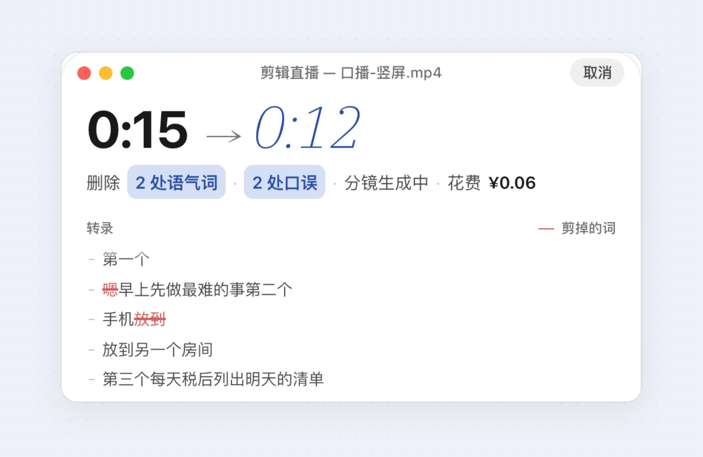
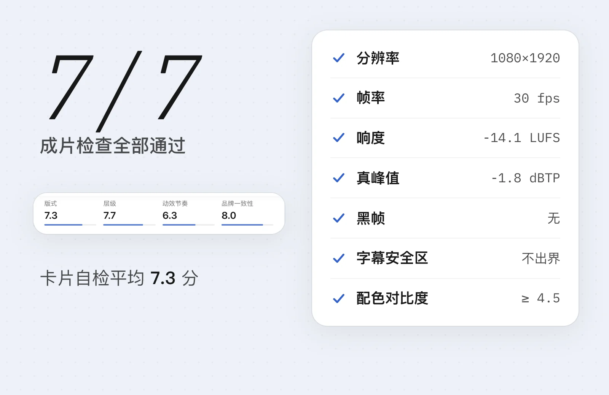
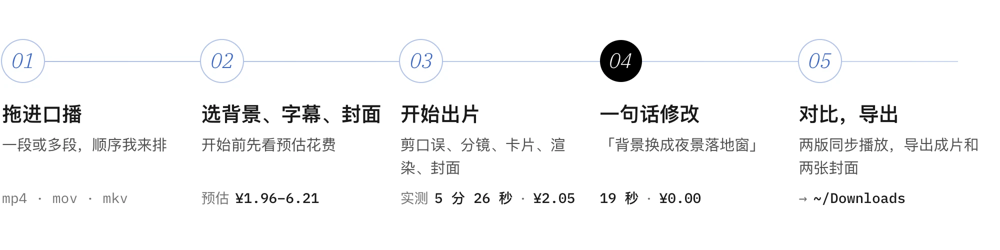

<div align="center">

<a href="#剪辑前后">
<picture>
  <source media="(prefers-color-scheme: dark)" srcset="docs/readme/hero-dark.webp">
  
</picture>
</a>

<h1>明知AI剪辑</h1>

开源的口播自动精剪工作台：剪口误、换背景、做分镜卡片和封面，<br>出一条能直接发的竖屏成片；哪里不满意，说一句就改。

**中文** · [English](README.en.md)

[![MIT][badge-license]][license] [![Node 22+][badge-node]][node] [![语音识别在本机][badge-asr]](#隐私) [![Remotion 4][badge-remotion]][remotion] [![macOS · Windows][badge-os]](#最低配置)

#### [剪辑前后](#剪辑前后) &nbsp;|&nbsp; [截图](#产品截图) &nbsp;|&nbsp; [功能](#功能) &nbsp;|&nbsp; [快速开始](#快速开始) &nbsp;|&nbsp; [花费](#花费) &nbsp;|&nbsp; [隐私](#隐私) &nbsp;|&nbsp; [常见问题](#常见问题)

</div>

<br>

## 剪辑前后

两条口播都是 AI 生成的虚构主播，故意留了「嗯」「那个」和「现在现在」这样的口误。下面是工作台直接出的首版成片，没有手动修过。


<p align="center"><sub><b>横屏原片 → 竖屏成片</b>　「怎么用 AI 剪口播」　剪掉 1 处语气词、3 处重复 · 换成极简工作室 · 5 个镜头、4 张卡片 · 用时 5 分 26 秒 · 花费 ¥2.05<br>
动图没有声音：<a href="docs/readme/before-after-landscape.mp4">打开 MP4 听成片（2.2 MB）</a></sub></p>


<p align="center"><sub><b>竖屏原片 → 竖屏成片</b>　「三个提高效率的小习惯」　剪掉 2 处语气词、2 处重复 · 换成图书馆 · 6 个镜头、5 张卡片 · 用时 6 分 15 秒 · 花费 ¥1.98<br>
<a href="docs/readme/before-after-portrait.mp4">打开 MP4 听成片（1.9 MB）</a></sub></p>

> [!NOTE]
> 文中数字除注明「2 分 12 秒样片」的几处外，都来自这两条样片的实测（2026-10-15，Apple 芯片 Mac）：用时是工作台记录的出片耗时，花费是可想 AI 实际扣的钱。

## 产品截图

工作台是一个本机网页：左边对话，右边预览。从放进口播到导出，全程不离开这一页。


<p align="center"><sub>首版成片。左栏是这一版剪了什么、分成几个镜头、卡片自检几分；右边的浮窗按镜头播放，暂停时能把当前画面「插入」到对话里。</sub></p>

<table>
<tr>
<td width="50%" valign="top"><br><sub><b>01 设置</b>　选背景、字幕和封面，右边实时示意；开始前先给出预估花费。</sub></td>
<td width="50%" valign="top"><br><sub><b>02 剪辑直播</b>　转录逐行出现，要剪的词先标红划掉，再收起来。</sub></td>
</tr>
<tr>
<td width="50%" valign="top"><br><sub><b>03 对话修改</b>　引用 <code>@00:07</code> 这张卡说一句，只重渲这一段，51 秒出 v3。</sub></td>
<td width="50%" valign="top"><br><sub><b>04 版本对比</b>　两版同步播放，进度条上标出哪几段变了。</sub></td>
</tr>
</table>

## 功能

<table>
<tr>
<td width="50%" valign="top">
<picture><source media="(prefers-color-scheme: dark)" srcset="docs/readme/feature-cut-dark.webp"></picture>

#### 剪口误

本机识别出逐字时间戳，大模型挑出要剪的地方，ffmpeg 按字剪。

**语气词** · **重复** · **口误** · **说错重来** · **长停顿压缩**

</td>
<td width="50%" valign="top">
<picture><source media="(prefers-color-scheme: dark)" srcset="docs/readme/feature-bg-dark.webp"></picture>

#### 换背景

整条原片抠像一次，之后换背景只重新合成，不再跑模型。

**10 个预设** · **上传图片** · **一句话生成背景** · **横屏原片按人物居中裁成竖屏**

</td>
</tr>
<tr>
<td width="50%" valign="top">
<picture><source media="(prefers-color-scheme: dark)" srcset="docs/readme/feature-board-dark.webp"></picture>

#### 自动分镜与卡片

按内容切镜头：要讲清楚的地方上半屏出信息卡，人物在下半屏；其余人物全屏。

**12 种卡片** · **B-roll 生图 / 生视频** · **配乐按情绪选** · **6 种字幕样式**

</td>
<td width="50%" valign="top">
<picture><source media="(prefers-color-scheme: dark)" srcset="docs/readme/feature-chat-dark.webp"></picture>

#### 对话修改

说一句话就出新版本，只重渲变了的镜头，旧版本都留着。

**引用 `@时间`** · **改卡片 / 背景 / 字幕 / 配乐 / 节奏** · **删一句、加回一句** · **回退到任一版本**

</td>
</tr>
<tr>
<td width="50%" valign="top">
<picture><source media="(prefers-color-scheme: dark)" srcset="docs/readme/feature-compare-dark.webp"></picture>

#### 版本对比

任意两版并排同步播放，拖一边另一边跟着走，改动的镜头直接标在进度条上。

**同步播放** · **差异标记** · **自检分对比**

</td>
<td width="50%" valign="top">
<picture><source media="(prefers-color-scheme: dark)" srcset="docs/readme/feature-qa-dark.webp"></picture>

#### 成片自检

每张卡片截图给读图模型打分，不达标就重写；成片再过 7 项硬指标。

**响度 -14 LUFS** · **真峰值 ≤ -1 dBTP** · **字幕安全区** · **配色对比度**

</td>
</tr>
</table>

另外每次出片会按所选风格生成 **3:4 与 4:3 两张封面**（10 种风格），人物是本机抠出来合成上去的，生图模型拿不到人脸。

## 快速开始

<picture>
  <source media="(prefers-color-scheme: dark)" srcset="docs/readme/flow-dark.webp">
  
</picture>

> [!TIP]
> **一键启动器正在做。** 做好之后下载安装包双击就能用，不用装 Node、不用敲命令。在那之前，请按下面的步骤从源码运行。

### 1. 准备

- [Node.js 22][node] 或更高，以及 [pnpm][pnpm]
- ffmpeg 与 ffprobe（优先用 `~/.mingzhi/bin/` 里的，也可以用环境变量 `MINGZHI_FFMPEG`、`MINGZHI_FFPROBE` 指定）
- 一个[可想 AI][kexiang] 账号（注册不需要邀请码），在控制台创建 key

### 2. 安装并启动

```bash
git clone https://github.com/crawfordxx/mingzhi.git && cd mingzhi
pnpm install
pnpm fetch-models   # 本机语音识别与抠像模型，下载到 ~/.mingzhi/models
pnpm fetch-assets   # 配乐与字幕字体，约 136 MB，下载到 ~/.mingzhi/assets
pnpm build:web      # 构建工作台网页
pnpm serve          # 启动本机服务，默认 http://127.0.0.1:4321
```

浏览器打开终端里打印的地址（端口被占用时会顺延）。第一次打开会让你粘贴可想 AI 的 key，先校验、通过才保存。

> [!WARNING]
> 模型和素材从 GitHub Releases 与上游站点下载，在中国大陆的部分网络下会失败；首次渲染还会下载约 94 MB 的 Chrome Headless Shell。需要代理时，在命令前加 `NODE_USE_ENV_PROXY=1`（Node 22.21 及以上），让 Node 使用 `HTTPS_PROXY` 等环境变量。所有下载都校验 sha256，中断后重跑会跳过已下载的文件。

### 3. 出片

1. **拖进口播**：一段或多段（mp4 / mov / mkv 等，单个不超过 4 GB），多段会按内容排好顺序再拼。
2. **选背景、字幕样式、封面风格**：右边预览会实时示意；底部能拖动本项目的花费上限，旁边是预估花费和明细。
3. **开始出片**：左边是剪辑直播，转录逐行出现、口误被划掉、镜头逐张生成；右边终端打印每一步。
4. **一句话修改**：成片出来后，在输入框说要改什么。暂停预览时点「插入」，可以引用 `@00:07` 这一刻的镜头。
5. **对比，导出**：打开「对比」两版同步播放；「导出」把成片和两张封面复制到 `~/Downloads/明知AI剪辑/`。

<details>
<summary><b>命令行用法</b>（不开工作台，一条命令出片）</summary>

<br>

```bash
export MINGZHI_KX_KEY=<你的可想 AI key>
pnpm mingzhi edit <口播视频.mp4> [-o 输出.mp4] [--work 工作目录] [--bg 预设id|背景图片] [--bg-prompt 一句话描述背景] \
  [--no-broll] [--max-videos N] [--budget 元] [--bgm auto|none|曲目id] [--caption-style 样式id] [--cover-style 风格id] \
  [--no-cover] [--no-qa] [--yes]
```

开始前会打印预估花费并等你确认（`--yes` 跳过）。不指定 `-o` 时，成片写到 `work/<视频名>/<视频名>_精剪.mp4`；工作目录里还留着 `project.json`（识别稿、剪切点、字幕、分镜等）、`cut.mp4` 和 `captions.ass`。

| 参数 | 说明 |
| --- | --- |
| `--bg` / `--bg-prompt` | 抠像换背景：预设 id、本地图片，或一句话描述（约 ¥0.20） |
| `--no-broll` | 不取 B-roll（截图、生图、生视频），依赖素材的图片卡改为人物全屏 |
| `--max-videos N` | 最多生成几段 B-roll 视频，默认 1（视频最贵） |
| `--budget 元` | 整条的花费上限，默认 10；预估超出时自动降级（先不用视频，必要时少生图） |
| `--bgm` | `auto` 按分镜情绪选曲（默认）、`none` 不加，或指定曲目 id（见 `assets/music.json`） |
| `--caption-style` | `blade` 刀锋（默认）、`wenkai` 文楷、`smiley` 得意、`minimal` 简约、`kuaile` 快乐、`song` 宋韵 |
| `--cover-style` | `bauhaus`（默认）、`swiss`、`memphis`、`editorial`、`neon`、`guochao`、`risograph`、`neobrutal`、`y2k`、`japanese` |
| `--no-cover` / `--no-qa` | 不生成封面 / 不做卡片自检 |

背景预设：`study` 书房、`studio` 极简工作室、`cafe` 咖啡馆、`night-window` 夜景落地窗、`tech-dark` 科技暗色、`japanese` 日式和室、`balcony` 绿植阳台、`library` 图书馆、`rooftop` 黄昏天台、`concrete` 水泥灰墙。

</details>

## 首次打开

Windows 版暂时没有代码签名，macOS 版在签名公证配好之前也是未公证的，所以**第一次打开会被系统拦一下**。这是系统对「没见过的新程序」的通用提示，放行一次之后，以后双击就直接打开。

<!-- 截图位置：docs/readme/first-open-macos.webp（系统设置 → 隐私与安全性里的「仍要打开」）、docs/readme/first-open-windows.webp（SmartScreen 的「更多信息」与「仍要运行」）。截图里不要出现个人账号与路径。 -->

#### macOS

下载 zip，双击解压得到「明知AI剪辑」，把它拖到「应用程序」文件夹（放在哪都行）。

- **macOS 15（Sequoia）及更新**：双击打开，系统提示无法验证、已阻止。点「完成」，打开「系统设置 → 隐私与安全性」，往下滑到「安全性」，找到「已阻止使用“明知AI剪辑”」，点右边的「仍要打开」，输入开机密码，再点一次「打开」。
- **macOS 14 及更早**：**右键**点「明知AI剪辑」→「打开」，在弹出的对话框里再点「打开」。

已公证的版本双击即可打开，不会有上面的提示。

#### Windows

下载 `Mingzhi.exe`，双击运行。出现蓝色的「Windows 已保护你的电脑」时，点窗口里的「**更多信息**」，再点出现的「**仍要运行**」。

浏览器下载时若提示「不常见的下载」：Edge 点下载条右边的「…」→「保留」→「仍然保留」；Chrome 在下载列表里点「保留」。

## 花费

软件免费，模型调用按量付费，直接从你的可想 AI 余额里扣，我们不经手。两条 15 秒样片的首版账单：

| 步骤 | 模型 | 「怎么用 AI 剪口播」 | 「三个提高效率的小习惯」 |
| --- | --- | ---: | ---: |
| 剪口误 | GPT-5.6 | ¥0.08 | ¥0.06 |
| 字幕校对、分镜 | Gemini 3.5 Flash | ¥0.13 | ¥0.11 |
| B-roll 生图 1 张 | GPT Image 2 | ¥0.20 | ¥0.20 |
| 卡片自检与重写 | Gemini 3.5 Flash | ¥0.38 | ¥0.36 |
| 封面 2 张（含选帧、核对标题） | GPT Image 2 | ¥1.25 | ¥1.26 |
| **首版合计** | | **¥2.05** | **¥1.98** |
| 之后的修改 | | 换背景 ¥0.00 | 改一张卡 ¥0.21、¥0.17 |

- 封面占了一大半；不要封面可以关掉（命令行 `--no-cover`）。对话里每说一句，规划修改另花 ¥0.03–0.04。
- 一条 2 分 12 秒的口播实测：剪到 2 分 02 秒、剪掉 2 处口误、花费 ¥3.76，7 项成片检查全过。
- 每个项目有花费上限（默认 ¥10），预估超出时自动降级；Seedance 生成 B-roll 视频最贵（约 ¥2.40 一段），上限不够时第一个被省掉。上面两条样片的上限设的是 ¥5，所以都没有用视频。
- 账户余额不足时会直接报错并提示充值，不会出半成品。

## 隐私

- **口播音频不出本机。** 语音识别用本地模型（SenseVoice），抠像也在本机跑。
- **大模型只拿到文字。** 剪口误、字幕校对、分镜只发送识别出的文字。
- **人脸不上传给生图模型。** 封面会把 6 帧缩略图拼图发给读图模型挑人物帧、再把生成的封面发回去核对标题；生图只收到文字提示词，并要求画面里没有人，人物是本机抠像后合成上去的。卡片自检发送的是卡片截图。
- **默认不收集任何数据**，没有统计、没有上报。服务只监听 `127.0.0.1`，并校验来源，别的网页调不动它。
- **key 存在系统钥匙串**（macOS 钥匙串；Windows 用 DPAPI 加密），钥匙串不可用时才退回本机数据目录。也可以只用环境变量 `MINGZHI_KX_KEY`，不落盘。

## 最低配置

- **处理器**：Apple M1，或 8 核 x86。抠像和渲染都在本机，样片在 Apple 芯片上抠像约 10–13 帧/秒。
- **内存**：16 GB。
- **磁盘**：约 500 MB 起（模型 243 MB、配乐与字体 128 MB、渲染用的 Chrome 约 94 MB），另加每个项目的中间文件。
- **网络**：能访问可想 AI；首次安装还要能下载模型与素材。

## 常见问题

<details>
<summary><b>为什么要可想 AI 的 key？</b></summary>
<br>
剪口误、字幕校对、分镜和自检要调用大模型，封面和 B-roll 要调用生图模型。可想 AI 一个 key 就能调这些模型，按量计费，国内能直接充值。
</details>

<details>
<summary><b>改一句话为什么这么快？</b></summary>
<br>
整条原片的抠像在首版就做完并缓存了，换背景只重新合成（样片 0.8 秒）；分镜按镜头分段渲染，只有变了的镜头重渲。在 2 分 12 秒的样片上，换背景从 35 秒降到 5.8 秒，改节奏从 61 秒降到 1.8 秒。
</details>

<details>
<summary><b>横屏原片能出竖屏吗？</b></summary>
<br>
能。横屏原片会按人物位置居中裁成 9:16 铺满，上面这条「怎么用 AI 剪口播」就是 1280×720 的横屏原片。
</details>

<details>
<summary><b>剪错了怎么办？</b></summary>
<br>
直接说「把 `@00:05` 那句加回来」之类的话出新版本，或者在任一版本上点「回退到此版本」。每个版本都保留，不会覆盖。
</details>

<details>
<summary><b>商用要注意什么？</b></summary>
<br>
本项目是 MIT 许可。但渲染依赖的 Remotion 有自己的许可证：超过 3 人的公司需要购买 Remotion 的公司许可证。抠像模型 RobustVideoMatting 是 GPL-3.0，见下方「许可证」。
</details>

<details>
<summary><b>开发与测试</b></summary>
<br>

```bash
pnpm typecheck && pnpm test
pnpm dev:web   # 前端热更新；配合 MINGZHI_DEV_PORT=5173 pnpm serve
```

README 里的图片由 `scripts/readme/` 生成：真实工作台截图 + HTML 模板渲染，剪辑前后对比由 ffmpeg 合成。
</details>

## 技术栈

| 环节 | 用的是 |
| --- | --- |
| 工作台 | React 18 · Vite · motion · 本机 Node HTTP 服务（SSE 推送进度） |
| 语音识别 | [sherpa-onnx][sherpa] + SenseVoice，本机运行 |
| 剪切 | ffmpeg（按字时间戳剪，长停顿压缩） |
| 抠像 | onnxruntime + [RobustVideoMatting][rvm] |
| 分镜、卡片、字幕 | 大模型出方案，[Remotion][remotion] 按帧渲染 |
| 模型 | 经[可想 AI][kexiang]：GPT-5.6、Gemini 3.5 Flash、GPT Image 2、Seedance |
| 成片检查 | ffmpeg ebur128 响度与真峰值、黑帧检测、字幕安全区、WCAG 对比度 |

## 发布

推送 `v<版本>` 标签（与 `package.json` 的 `version` 一致）或在 Actions 页手动运行「发布」工作流：macOS（Apple 芯片、Intel）与 Windows 各自打应用本体包、编译启动器并做解包与渲染烟测，最后创建**草稿** Release，检查无误后手动发布。

> [!NOTE]
> 启动器从本仓库的 GitHub Releases 下载应用本体包。**仓库公开后，Release 里的文件才能被匿名下载**；私有仓库或草稿 Release 的下载地址会返回 404。

## 许可证

[MIT][license]

**Remotion**：个人、非营利组织和不超过 3 人的公司可免费使用；**超过 3 人的公司需要购买 [Remotion 公司许可证][remotion-license]**。

第三方素材都不随仓库分发（音效除外），运行时从上游下载：

- 配乐：HoliznaCC0 的作品，CC0 1.0，来自 [OpenGameArt][oga]（`pnpm fetch-assets`）
- 音效：[Kenney][kenney] 的 Interface Sounds，CC0，已放在 `assets/sfx/`
- 字体：SIL OFL 1.1（Noto Sans SC、Noto Serif SC、LXGW WenKai、得意黑 Smiley Sans、ZCOOL KuaiLe 等）（`pnpm fetch-assets`）
- 抠像模型：[RobustVideoMatting][rvm]，代码与权重为 GPL-3.0（`pnpm fetch-models`）

<br>

<div align="center">
<br>
<sub>README 里的两位主播、封面示例和插画都是 AI 生成的，不是真人。</sub>
</div>

<!-- 链接 -->
[license]: LICENSE
[node]: https://nodejs.org
[pnpm]: https://pnpm.io
[kexiang]: https://kexiangai.com
[remotion]: https://www.remotion.dev
[remotion-license]: https://www.remotion.dev/license
[rvm]: https://github.com/PeterL1n/RobustVideoMatting
[sherpa]: https://github.com/k2-fsa/sherpa-onnx
[oga]: https://opengameart.org
[kenney]: https://kenney.nl
[badge-license]: https://img.shields.io/badge/license-MIT-014DF9?style=flat-square
[badge-node]: https://img.shields.io/badge/node-%E2%89%A522-1f1f22?style=flat-square
[badge-asr]: https://img.shields.io/badge/%E8%AF%AD%E9%9F%B3%E8%AF%86%E5%88%AB-%E6%9C%AC%E6%9C%BA-5c81d6?style=flat-square
[badge-remotion]: https://img.shields.io/badge/render-Remotion%204-1f1f22?style=flat-square
[badge-os]: https://img.shields.io/badge/macOS%20%C2%B7%20Windows-1f1f22?style=flat-square
