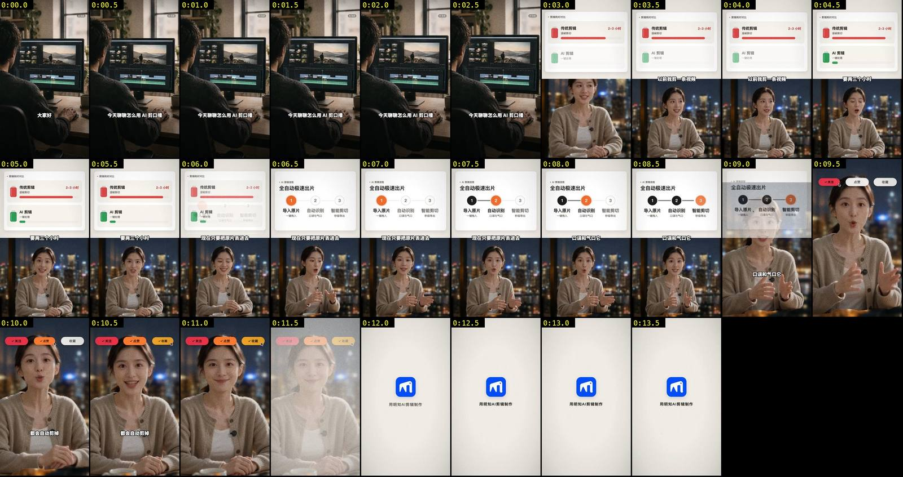
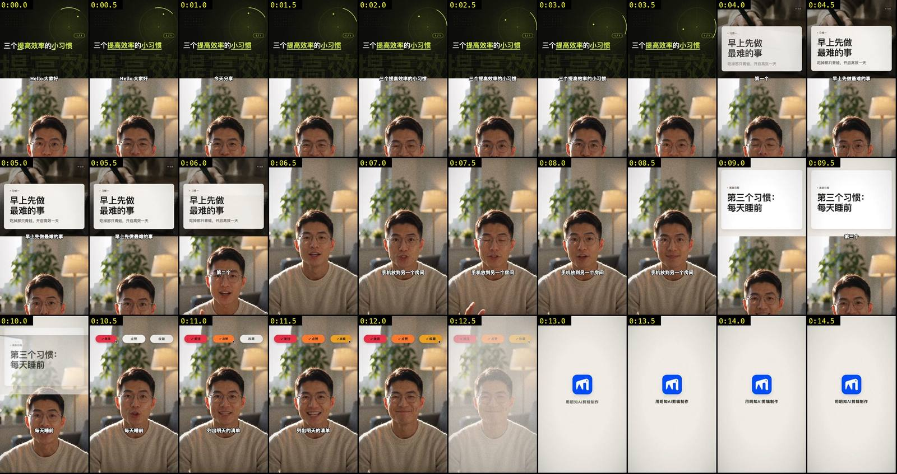
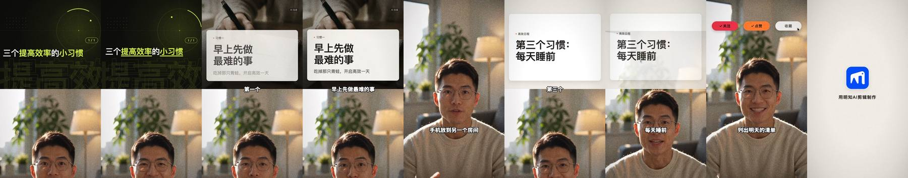
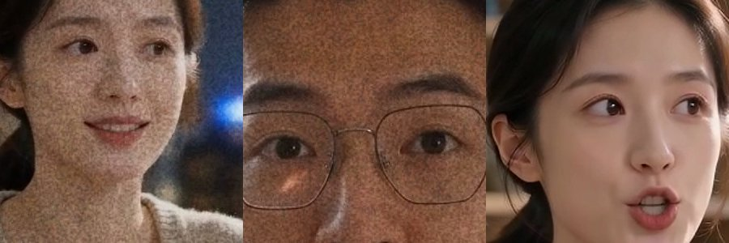

# P7 出片品质 · 实测验收

> 方法与基线见 `docs/acceptance/p7-audit.md`（第 0、1、3、4 节）。本文引用的图都来自两条 AI 虚构主播的 mock 片，不含真人。实测 2:12 样片因可想 AI 余额不足没出成片，暂记「待验收」（见第 6 节）。
> 代码版本：`feat/p7-quality` @ `874b710`。验收只跑片、审片，没有改代码。

---

## 0. 结论

**未达标。** 两条 mock 片的综合分是 **5.6（横屏）和 5.0（竖屏）**，比 README 旧样片的 ≈4.4 高，但离目标综合 ≥ 8、单维 ≥ 7 还差得远，也低于黄金样本的 ≈6.7。

| 验收项 | 目标 | 横屏 mock | 竖屏 mock | 实测 2:12 |
|---|---|---|---|---|
| 综合分 | ≥ 8 | 5.6 | 5.0 | 待验收 |
| 单维最低 | ≥ 7 | 4（调色与质感） | 4（构图、B-roll、调色） | 待验收 |
| 摄影级画面覆盖（按成片时长） | ≥ 25% | 22%（产品口径按口播时长算是 28%，能通过） | **15%**（产品口径 19%，整片自检也判了不达标） | 待验收 |
| 实拍视频 ≥ 3 段 | ≥ 3 | 0 | 0 | 待验收 |

「实拍视频 ≥ 3 段」这一条**这次无法验证**：本机没有 Pexels 和 Pixabay 的 key，免 key 的来源只剩 Openverse 和 Wikimedia。它们只提供照片，而且检索出来的 35 个和 49 个候选在审片环节全部落选。所以两条片的 B-roll 都是 GPT Image 生成的图，实拍视频是 0 段。

P7 确实做到了这些：第 0 帧不再是空的；静止超过 3 秒的段降到 0；卡片会随口播逐步展开（流程卡逐个点亮）；相邻卡片之间不再闪一下空底；有了 AI 生成角标和署名记录（credits.json）；音效从 1 种增加到 3–5 种；有了品牌片尾，片尾 3 秒响度在 -22 LUFS 左右。

但 P7 新加的**颗粒层把人脸做成了「麻点」**，直接把质感拉低了一档。短片里还有几处结构问题：CTA 压住了最关键的那句话、片尾占了 15–18% 的片长、有的节拍没配上画面。

### 最大的 3 个剩余差距

1. **没有真实世界的画面**：B-roll 全部是生成图。横屏只有 1 张图、3.1 秒；竖屏放了 2 张，一张被整片自检撤掉了，另一张被卡片挡住大约 70%。免费来源找到的候选从来没有被选中；短片的 B-roll 上限是 ¥1，第 3 个节拍（「手机放到另一个房间」）因此被跳过。
2. **质感倒退**：颗粒太重，1:1 看人脸全是彩色噪点（见 3.3 节的 `grain-crop.jpg`）。它还让成片码率涨到 34–42 Mbps：15 秒的片子 60–80 MB，README 对比用的 MP4 也从 2 MB 涨到 5–7 MB。另外，米白卡配夜景人像（横屏）、暗绿科技风钩子配暖色台灯（竖屏），一条片里各有两套色彩，没有统一。
3. **短片的结构与构图**：CTA 被提前到「倒数 5–8 秒」，12 秒的片子里正好压在收益句上（横屏 9.1–11.1s 盖住「都会自动剪掉」，竖屏 10.1–12.1s 盖住「列出明天的清单」）。片尾 2.2–2.7 秒，占了 15–18% 的片长。竖屏没换背景，拿不到人物框，分屏里人头被压到画面底边（0:00–6.2、9.0–10.1）。

---

## 1. 三条片的数据与花费

### 1.1 运行情况

| | 横屏 mock | 竖屏 mock | 实测 2:12 样片 |
|---|---|---|---|
| 原片 | `mock/landscape.mp4` 1280×720 · 0:15 | `mock/portrait.mp4` 720×1280 · 0:15 | `work/raw1/raw1.mp4` 360×640 · 2:12（真人，只在本机看） |
| 参数 | `--bg night-window --budget 10 --yes` | `--budget 10 --yes`（保留原背景） | `--bg studio --budget 10 --yes`（与 try2 相同的背景） |
| 结果 | 完成，用时 4 分 48 秒 | 成片已渲染、整片自检已做完；**封面一步余额不足**，CLI 退出码 1 | **分镜一步余额不足**，没有成片 |
| 删除 | 4 处（1 处语气词、3 处重复） | 4 处（2 处语气词、2 处重复） | 2 处（cuts 已完成） |
| 成片 | 14.2s（口播 11.1s + 片尾） | 15.2s（口播 12.1s + 片尾） | — |
| 镜头 | 4 个：全屏 B-roll → compareBars → flow → 全屏 CTA，加品牌片尾 | 5 个：hook → title（铺图）→ 人物全屏 → title → 全屏 CTA，加品牌片尾 | — |
| B-roll | 节拍 3 个，检索 1 个；候选 4 个（Openverse 22、Wikimedia 13）；入选**生成图**，全屏插入 1 次 | 节拍 4 个，2 个没有可放的镜头；候选各 9 个；2 个入选**生成图**；第 3 张「超出预算」（短片 B-roll 上限 ¥1）；自检时撤掉了钩子底图 | — |
| 卡片自检 | 2 张，全部通过 | 3 张，重写 2 次 | — |
| 整片自检 | 8/8 | 首轮 7/8（铺图可读性）→ 局部重做 → **7/8（摄影级画面覆盖 19%）**；但「成片检查」打印的是 8/8 通过，`film.unfixed` 也是空的，口径不一致 | — |
| 响度 | -14.2 LUFS · LRA 5.9 · 峰值 -1.7 dBFS；片尾 3 秒 -22.4 LUFS | -14.7 LUFS · LRA 7.3 · 峰值 -1.9 dBFS；片尾 3 秒 -22.9 LUFS | — |
| 码率 / 体积 | 33.7 Mbps · 60 MB | 41.9 Mbps · 80 MB | — |

### 1.2 花费（可想 AI，`project.json.costs` 已落盘）

| 项目 | 横屏 | 竖屏 | 实测 2:12 |
|---|---|---|---|
| 剪口误 / 字幕校对 / 分镜 | ¥0.07 / ¥0.05 / ¥0.07 | ¥0.06 / ¥0.04 / ¥0.14 | ¥0.16 / ¥0.16 / ¥0.20（分镜报余额不足） |
| 视觉节拍 + B-roll 审片 | ¥0.11 | ¥0.20 | — |
| B-roll 生图 | ¥0.30（1 张） | ¥0.60（2 张，其中 1 张后来被自检撤掉） | — |
| 卡片自检与重写 | ¥0.07 | ¥0.29 | — |
| 封面 | ¥1.25（底图 ¥1.20） | ¥0.03（选帧之后余额不足） | — |
| **合计** | **¥1.93** | **¥1.35** | **¥0.52** |

**三条合计 ¥3.80**，每条都在 ¥10 上限以内。

### 1.3 余额不足时的产品表现

- **符合预期**：两次都是直接报错，没有降级、没有重试。CLI 打出「已花费 ¥X」、充值地址 `https://kexiangai.com`、「重跑会重新付费：只有 B-roll 素材与封面底图有缓存」和「出错了：可想 AI 账户余额不足，请充值后重试」，退出码 1。`project.json.costs.total` 与打印的已花费一致（竖屏 1.354 对 ¥1.35，实测 0.519 对 ¥0.52），已花费正确落盘。
- **不符合预期**：竖屏的成片 `output.mp4` 其实已经完整写出（响度归一化和成片检查都做完了），只是封面失败。但 CLI 只打印「出错了」，**没有告诉用户成片已经生成、路径在哪**，用户会以为整条白跑了。封面是可选产物，余额不足时应该提示「成片已完成，封面因余额不足未生成」，并照常给出成片路径（`src/cli.ts`、`src/pipeline/run.ts` 的封面步骤）。

---

## 2. 定量指标（与 p7-audit 第 1 节同法）

方法：108×192 灰度、5 fps，只看上半屏（y < 84/192）。硬切：相邻 0.2s 平均差 > 25。静止：差 < 0.8 连续超过 3s。空白率：6×6 块标准差 < 2.5 的比例。色彩丰富度用 Hasler-Süsstrunk。纹理帧：上半屏 3×3 拉普拉斯绝对值 > 12 的像素占比 > 35%。纹理帧的阈值是用 p7-audit 留下的灰度数据重新标定的，在黄金样本上算出 40.2%（报告里是 39%），try2 是 0%；README 旧样片按新阈值重算。

| 指标（上半屏） | 黄金样本 | 自动 try2 | README 旧 44d799db v3（竖） | README 旧 41839b42 v2（横） | **P7 横屏** | **P7 竖屏** |
|---|---|---|---|---|---|---|
| 时长 | 117.4s | 122.2s | 12.2s | 11.2s | 14.2s | 15.2s |
| 硬切次数 / 平均镜头时长 | 15 / 7.3s | 11 / 10.2s | 5 / 2.0s | 3 / 2.8s | 3 / 3.6s | 5 / 2.5s |
| 分镜镜头数 | ≈20 | 22 | 6 | 5 | 4 + 片尾 | 5 + 片尾 |
| 静止 > 3s 合计 | 20.0s | 62.4s | 0 | 0 | **0**（最长 1.8s） | **0**（最长 1.8s） |
| 上半屏空白率 | 40.8% | 55.3% | 27.7% | 46.6% | 41.0% | 41.3% |
| 首帧上半屏空白率 | 28% | 99.6% | 1.6% | 35.7% | **5%** | 46%（暗底钩子，有完整标题） |
| 色彩丰富度 | 25.1 | 16.3 | 26.6 | 26.5 | 29.6 | 27.8 |
| 平均饱和度 | 52 | 21 | 70 | 55 | 36 | 56 |
| 纹理帧占比（含人物全屏） | 40% | 0% | 21% | 16% | 25% | 32% |
| 摄影级画面（结构口径，按成片时长） | ≈15–17% | 0% | 约 2 张生图（同一张用了两次） | 1 张生图 | **22%**（3.1s） | **15%**（2.3s） |
| 实拍视频段数 | 0 | 0 | 0 | 0 | 0 | 0 |
| 片尾占比 | 3% | 0（截断） | 0 | 0 | 15%（2.2s） | 18%（2.7s） |

---

## 3. 抽帧审片

### 3.1 横屏 mock（「怎么用 AI 剪口播」，夜景落地窗）




| 时间 | 观察 |
|---|---|
| 0:00–0:03 | 全屏 B-roll：生成图，人在显示器前剪片，有时间线和素材格，带「AI 生成」角标，有轻推近。**第 0 帧就有完整画面**，题材也对得上，比旧版的「笔电绿植」「机器人」好很多。但画面上没有任何钩子文字或数字，只有字幕「大家好 / 今天聊聊怎么用 AI 剪口播」。开头 3 秒有画面，却没有冲突、没有数字 |
| 0:03–0:06 | compareBars：「传统剪辑 2–3 小时」红色长条对「AI 剪辑 一键处理」绿色短条，这次有真正的对比。卡片只占上半屏的 50% 左右，上下各留一大块米白；副标题「逐帧剪切」字号很小 |
| 0:06.0 | compareBars 叠化到 flow，两张卡**重影约 0.3 秒**（不再闪空底，但两套版式叠在一起很脏） |
| 0:06–0:09 | flow「全自动极速出片」，1→2→3 随口播逐个点亮。这是全片最好的段落 |
| 0:09.0 | flow 的残影叠在全屏人像上淡出 |
| 0:09–0:11 | 全屏人像，顶部 CTA 胶囊「关注 / 点赞 / 收藏」，光标逐个点击。**CTA 和收益句「口误和气口它都会自动剪掉」同时出现**，抢掉了这条片最该被记住的一句 |
| 0:11.5–0:14.2 | 叠化到米白底，中间一个小 logo 加「用明知AI剪辑制作」，静止 2.2 秒。对 11 秒的口播来说太长，画面也太素 |
| 全片 | 上半屏是暖白卡，下半屏是夜景蓝黑：两个色彩世界。人物脸上颗粒很重（见 3.3） |

### 3.2 竖屏 mock（「三个提高效率的小习惯」，保留原背景）




| 时间 | 观察 |
|---|---|
| 0:00–0:04 | hook：暗绿黑底，雷达圆环在转，标题「三个**提高效率**的**小习惯**」关键词黄绿高亮，背景是描边大字「提高效」，配 riser 和 hit。第 0 帧内容完整，这一点比旧版好。但**钩子原本铺了一张生成图，自检判定文字对比度只有 3.9，就把底图撤了**（¥0.30 白花），退回纯图形钩子；而且暗绿科技风和下半屏的暖色台灯客厅完全不搭 |
| 0:00–0:06 | **人物构图出了问题**：没换背景就拿不到人物框（`subject = null`），分屏按默认头顶位置放，眼睛压在画布底边，下巴出画，下半屏大部分是背景（`portrait-framing.jpg`：左边是旧版，右边是 P7） |
| 0:04–0:06 | title「习惯一 · 早上先做最难的事」，铺图变体：底图是握笔的手（生成图），压暗以后被玻璃卡盖住大约 70%，看起来更像纹理而不是画面。卡片的字号和层级是全片最好的 |
| 0:06–0:09 | 「第二个 · 手机放到另一个房间」**没有任何画面**，只有人物全屏：这个节拍被归为「没有可放的镜头」，补图又因为「超出预算」被跳过。三个习惯里只有这一个没有视觉，结构不对称 |
| 0:09–0:10 | title「第三个习惯：每天睡前」只停 1.1 秒，底图被自检撤掉，成了一张只有标题的白卡；字幕「第三个」压在卡片下沿 |
| 0:10–0:12 | CTA 胶囊加光标，**正好盖住第三个习惯的内容「列出明天的清单」**，观众看到的是「关注点赞」，不是习惯本身 |
| 0:12.5–0:15.2 | 米白品牌片尾，静止 2.7 秒，占片长 18% |

### 3.3 质感问题特写



左边两张是 P7 成片的 1:1 裁切，右边是原片。颗粒表现成**带色的粗点**，人脸像长了雀斑，完全不是胶片颗粒的那种细腻质感。它也是成片码率暴涨（34–42 Mbps）的主要原因：噪声没法被压缩。


---

## 4. 10 维打分（与基线逐维对比）

| 维度 | try2（基线） | README 旧样片（基线） | 黄金样本 | **P7 横屏** | **P7 竖屏** | 依据（时间点） |
|---|---|---|---|---|---|---|
| 叙事与节奏 | 4 | 5 | 7 | **6** | **5** | 横：钩子图 → 对比 → 流程点亮 → CTA，单元清楚，没有静止段；但片尾拖了 2.2 秒。竖：习惯 2（0:06–0:09）没有画面，习惯 3 的卡只停 1.1 秒，内容被 CTA 盖住，三段不对称 |
| 画面构图 | 4 | 5 | 7 | **6** | **4** | 横：全屏 B-roll 构图好，卡片占上半屏约 50%，空白率 41%。竖：分屏里人头压到底边（0:00–6.2、9.0–10.1）；0:09.5 白卡只有标题 |
| B-roll 选材与审美 | 1 | 3 | 6 | **5** | **4** | 横：1 张题材对路的生成图，全屏 3.1 秒，有角标和推近。竖：握笔手的图被卡片挡住，钩子图被撤，手机节拍被跳过。两条都是 0 张真实素材、0 段实拍 |
| 信息卡设计 | 5 | 5 | 7 | **6** | **5** | 横：compareBars 有真对比，flow 逐步点亮；副标题字太小。竖：只用了 hook 和 title，0:09 的 title 卡空洞 |
| 字幕 | 6 | 6 | 7 | **6** | **6** | 和基线一样的 blade 粗描边，没有关键词强调；分屏时字幕骑在分界线上（横 0:03.5、竖 0:09.5） |
| 调色与质感 | 4 | 4 | 6 | **4** | **4** | 颗粒做成彩色麻点（3.3 节），比基线还退步；横屏米白卡配夜景，竖屏暗绿钩子配暖光客厅，各有两套色彩；生成图做了 LUT，色调统一，这一点是加分 |
| 转场与动效 | 4 | 4 | 6 | **6** | **5** | 不再闪空底；流程卡点亮、CTA 光标点击、B-roll 推近都是进步。横 0:06.0、竖 0:10.0 的叠化重影很脏；没有遮罩或匹配剪辑 |
| 声音（只测响度与音效清单） | 4 | 4 | 6 | **6** | **6.5** | 横 3 种 6 个音效，竖 5 种 8 个（有 riser 和 hit）；片尾 3 秒 -22.4 / -22.9 LUFS，有 logo 音；整体 -14.2 / -14.7 LUFS |
| 开头 3 秒钩子 | 3 | 4 | 8 | **5** | **5** | 横：第 0 帧就是全屏实景感画面，但没有钩子文字、数字或冲突。竖：第 0 帧标题完整，有高亮，但只是一个图形，没有画面，人物构图也坏了 |
| 结尾 | 3 | 4 | 7 | **6** | **5** | 不再截断，有 CTA 和品牌片尾；但 CTA 压住收益句（横 9.1–11.1s，竖 10.1–12.1s），片尾占 15–18%，米白底只有一个小 logo |
| **综合** | **≈3.8** | **≈4.4** | **≈6.7** | **5.6** | **5.0** | 目标 ≥ 8、单维 ≥ 7：**均未达到** |

---

## 5. 已知限制

- **实测 2:12 样片没有验收**：可想 AI 余额不足，分镜一步就停了。长片才能真正检验的几项（每 15 秒至少 1 个真实画面、模板多样性、静止时长上限、音效重复、局部重做）这次都没有数据。两条 mock 只有 11–12 秒，静止和多样性指标在这么短的片子上很容易通过，不能代表 2 分钟成片。
- **没有图库 key**：「实拍视频 ≥ 3 段」验证不了。Openverse 和 Wikimedia 只有照片，最大 1024px，这次全部落选。
- **声音没有逐帧听审**：只测了响度、片尾响度和音效清单，和基线报告一样。
- **竖屏没有封面**：封面一步余额不足；成片本身完整，可以审。
- **竖屏和旧 README 样片的背景不同**（旧版换成图书馆，这次保留原背景）。也正因为这样才暴露出「不换背景时拿不到人物框」的问题。

---

## 6. 实测样片的补跑方法

充值后在 worktree 里执行（`<临时目录>` 是本机 scratchpad；成片含真人，只在本机看，帧和联系表都不入库）：

```bash
source <临时目录>/kx.env
NODE_USE_ENV_PROXY=1 pnpm mingzhi edit /Users/crawford/workspace/mingzhi/work/raw1/raw1.mp4 \
  -o <临时目录>/p7-accept/raw1/output.mp4 --work <临时目录>/p7-accept/raw1/work \
  --bg studio --budget 10 --yes
```

预估 ¥5.20–¥14.70，超过上限时会自动降级（不用 Seedance，必要时少生图）。审片沿用第 2 节的脚本和 p7-audit 第 1 节的方法；B-roll 覆盖要分别按口播时长和成片时长各算一次。

---

## 7. 下一步（按收益排序）

1. **颗粒层重做**（`render/layers/GrainLayer.tsx`）：改成只有亮度、不带颜色的细颗粒，按 1080 宽做 1:1 的像素尺寸，强度降到肉眼在手机上刚能察觉，人物区域再减弱。整片自检加一项「人脸区域高频噪声」。预计调色与质感 +2，成片体积降到原来的 1/5 左右。
2. **真实素材优先**（`src/broll/select.ts`、`src/pipeline/broll-step.ts`、`src/broll/sources/openverse.ts`）：免费源的候选要能在审片时和生成图公平竞争，不能被分辨率一刀切掉（分屏和画中画用 1024px 已经够了）。生成图只在真实候选相关度不够时才用。验收环境建议配一个 Pexels key，用来验证实拍视频那一条（要不要配由用户决定）。预计 B-roll +2。
3. **短片的 B-roll 上限与节拍落位**（`src/broll/budget.ts` 的 `MIN_CAP_YUAN = 1`、`broll-step` 里「没有可放的镜头」的处理）：30 秒以内的片子至少要能付得起 3 张图；落在人物全屏镜头上的节拍改成画中画或全屏插入，不要直接丢掉。竖屏的习惯 2 就是被这两条同时卡掉的。
4. **CTA 与片尾按片长折算**（分镜阶段 CTA 提前的规则、`render/templates/Outro.tsx`）：CTA 不能和最后一个内容句重叠，短片里放到最后一句之后；片尾时长 ≤ 片长的 8%（短片 1–1.2 秒），底色跟随全片色调，不要固定米白。
5. **不换背景时也要拿到人物框**（`src/compose/layout.ts` 的 `DEFAULT_TOP`、拿人物框的那一步）：不抠像时也跑一次人物检测或用视觉模型定位头顶；拿不到时分屏默认居中，而不是压到底边。
6. **整片自检不要撤掉付费底图**（`src/qa/film-redo.ts`）：钩子底图对比度不够时，先压暗或换文字位置，撤图放到最后一步；撤图之后要复检覆盖率，并把结果如实写进 `film.unfixed`。同时修正「整片自检 7/8」和「成片检查 8/8」打印口径不一致的问题（`src/pipeline/qa-step.ts`）。
7. **卡片与钩子的配色跟随背景**（`render/templates/*`、`render/layers/CardLayer.tsx`）：夜景、暗色背景用深色玻璃卡；钩子不要固定暗绿科技风，要跟着全片的 LUT 和背景主色走。
8. **版式不同的卡片之间改用遮罩或推移转场**（`render/layers/CardLayer.tsx`）：compareBars 到 flow 这类结构差异大的卡片之间，不要用 0.3 秒叠化。
9. **全屏 B-roll 上加钩子文字**（分镜规则、`render/layers/BrollLayer.tsx`）：开头用全屏素材时，叠一行钩子标题或数字（例如「2–3 小时 → 一键」），让前 3 秒同时有画面和冲突。
10. **余额不足时保住已完成的成片**（`src/cli.ts`、封面步骤）：封面失败时照常输出成片路径，并提示只补跑封面即可。
